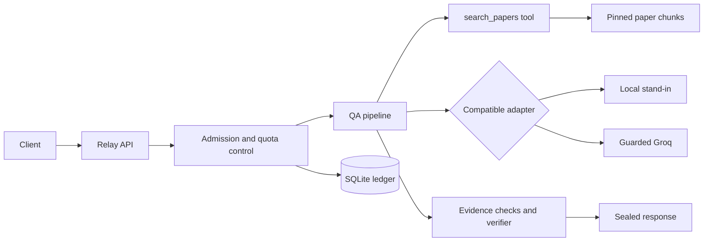

# Relay

A paper-grounded QA service with evidence checks, quota-aware admission and an OpenAI-compatible stand-in for local load testing.

## Project overview

I built Relay around one rule: an answer reaches the user only after validation. It searches three pinned papers, drafts claims with supporting quotes, checks the quotes and asks a verifier to assess support. When it cannot verify an answer, it abstains.

## Problem being solved

A fast model call does not guarantee a fast answer. Retrieval, verification, retries and queueing share the same deadline and quota. Relay reserves work before admitting it and rejects requests it cannot finish safely.

## Architecture



## End-to-end request lifecycle

Interpret → `search_papers` tool → evidence gate → draft → deterministic validation → verifier → optional single repair → sealed release.

The gate can broaden retrieval. A failed check can lead to one repair if the deadline and token budget allow it. Unverified draft text is never streamed to the client.

## Retrieval and evidence validation

The library contains exactly Transformer **1706.03762 v7**, Moshi **2410.00037 v1**, and Dynamic Chunking **2507.07955 v2**. Citation pages are one-based PDF pages.

| Setting | Chunk target / overlap | Retrieval |
|---|---|---|
| A | 256 / 40 tokens | BM25, six chunks |
| B | 512 / 64 tokens | BM25, four chunks |
| C | 384 / 48 tokens | Hybrid, twelve candidates to four, reranking when available |

Each claim carries a chunk ID and quote. Code checks membership, pinned metadata, normalized substring membership and numeric support. Citations come from stored metadata. A missing or malformed verifier result fails validation. Gold references remain outside retrieval and provider prompts.

## Provider and stand-in design

The same HTTP adapter supports Groq and a local compatible stand-in. Stand-in is the default. It can stream, slow down under load, fail and return simulated quota errors. Its scripted answers exercise the pipeline; their quality does not predict Groq answer quality.

## Quota management and admission control

Admission checks queue space, projected wait, deadlines and minute/day budgets. Real attempts require durable SQLite reservations. Actual usage and provider headers reconcile them; missing cached usage remains unknown. Console limits and timestamped response headers retain separate provenance.

## Retry, cache and circuit-breaker strategy

The orchestrator owns retries; transport retries are disabled. Bounded retries share a request-wide limit and global budget, with jitter and deadline checks. Only verified results enter the cache. Single-flight combines identical work. A breaker stops repeated failing work. Daily exhaustion still permits eligible verified cache hits.

## Experiments and results

There are two historical Groq attempts: connectivity and an end-to-end smoke. The smoke safely abstained after quote validation failed. Real A/B/C quality remains unmeasured; fresh quota evidence is required before further real evaluation.

Local A/B/C outputs and load runs are retained separately. Development runs are uncalibrated. One draft timing sample does not establish a latency distribution or verifier behaviour. Output reviews record rationale, uncertainty and reviewer provenance; a valid citation alone does not establish a complete answer.

## Repository structure

| Path | Contents |
|---|---|
| `relay/app/` | Interpretation, prompts, validation and sealed delivery |
| `relay/control/` | Admission, limiter, ledger, retries, scheduling and breaker |
| `relay/providers/` | HTTP adapter, parsing and real-call guard |
| `relay/retrieval/` | PDF ingestion, chunks and search |
| `standin/`, `loadgen/` | Simulation and open-loop HTTP experiments |
| `eval/` | Versioned questions, isolated references and grading tools |
| `scripts/` | Aggregation, reports and submission checks |
| `config/` | Typed application and experiment configuration |
| `results/` | Ignored local evidence and preserved historical runs |
| `relay-submission/` | Final local package: PDF, code, CSV and raw records |

## Setup instructions

Use Python 3.11+ and uv:

```powershell
uv sync --locked --extra dev
uv run --locked --extra dev python -m relay.retrieval.ingest --dense
```

Ingestion downloads configured paper/model assets, verifies pinned PDF versions and builds local indexes. It does not call Groq. Keep generated caches out of Git.

## Running tests

```powershell
uv run --locked --extra dev python -m pytest
uv run --locked --extra dev python -m ruff check .
uv run --locked --extra dev python -m ruff format --check .
```

`make test` runs the same suite. Tests use fixtures and local services, not Groq. Mypy is not configured.

## Running the application

Start these in separate terminals:

```powershell
uv run --locked --extra dev python -m standin.service --profile development
uv run --locked --extra dev python -m relay.app.api
```

The API exposes `/ask`, `/health` and `/state`. Keep one worker because admission and quota state are process-local. `python -m relay.app.api --check` checks startup configuration.

## Running stand-in scenarios

```powershell
uv run --locked --extra dev python -m loadgen --help
uv run --locked --extra dev python -m loadgen run --scenario development_smoke --output-root results/my-local-run
```

Use a fresh output root. Calibrated scenarios enforce account/profile/capacity prerequisites. Historical development runs remain available when later runs supersede them in a table.

## Running retrieval evaluation

```powershell
uv run --locked --extra dev python -m eval.dataset
uv run --locked --extra dev python -m eval.runner --settings A B C --base-url http://127.0.0.1:8081/openai/v1 --output results/my-evaluation
```

The second command needs the local stand-in running. It does not assign correctness grades. `python -m eval.grade --help` describes human review. Separate assistant reviews never claim human confirmation.

## Real Groq configuration and safety

Keep the key in private environment configuration. Real startup requires `RELAY_PROVIDER=groq`, `RELAY_ALLOW_REAL=1` and explicit `--real`. `RELAY_REAL_TOKEN_CAP` and `RELAY_REAL_REQUEST_CAP` enforce reservations. Never copy credentials into commands, logs or reports.

The standalone smoke allowance is consumed. Do not repeat it. Candidate A/B/C evaluation additionally requires fresh quota evidence and a safe complete-batch plan. Historical remaining-quota headers are not current quota. Probe commands default to dry-run.

## Results and provenance

`results/results.csv` remains the original 84-row P6 file. The combined CSV is generated at `results/p7/results.csv` and copied to `relay-submission/results.csv`. This preserves historical bytes.

```powershell
uv run --locked --extra dev python -m scripts.prepare_p7
uv run --locked --extra dev python -m scripts.aggregate --submission
uv run --locked --extra dev python -m scripts.report
uv run --locked --extra dev python -m scripts.package_submission
uv run --locked --extra dev python -m scripts.check_submission --structural-only
uv run --locked --extra dev python -m scripts.check_submission
```

The final check blocks when evidence or approvals are missing. Aggregation is the sole calculator for tables. Manifests distinguish real observations, development measurements, fitted values, assumptions and missing measurements. Archives retain earlier PDFs and failed attempts.

## Limitations and known gaps

Real A/B/C quality, verifier timing, complete calibration, real quota-error behaviour and recovery are not measured. Development results cannot establish Groq capacity. Genuine Limits/Usage screenshots are included; exact current remaining quota and full conversation exports are unavailable. Candidate approval of references, grades and feedback remains outstanding. Drive upload and form submission are separate actions.

There is no distributed limiter or per-user fairness. A correctly quoted sentence can still omit material parts of a question; the output review checks completeness as well as support.
