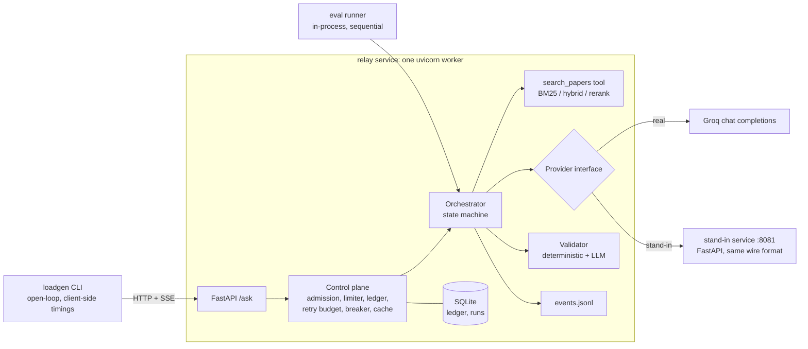
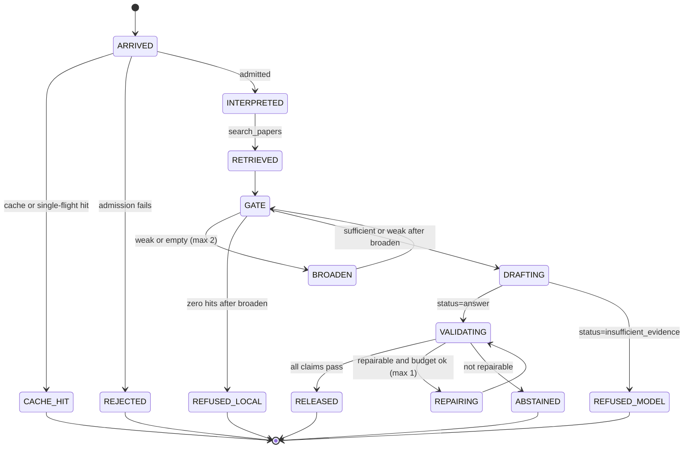

# 02. Architecture

## 1. Processes



Single worker on purpose: the limiter and queue state live in memory, so more workers would split the accounting. State that as a limitation.

## 2. Request state machine



Terminal states map to the CSV: RELEASED / REFUSED_* / CACHE_HIT -> `ok`; REJECTED -> `rate_limited`; deadline -> `timeout`; ABSTAINED / provider errors -> `error`.

**Invariants (tests must enforce these):**
1. Nothing is emitted to the client before state RELEASED/REFUSED/ABSTAINED/REJECTED.
2. Every cited `chunk_id` was in this request's retrieved set; every quote is a substring of its chunk.
3. Every citation shown to the user carries the pinned arXiv version from metadata.
4. At most 1 repair, at most 1 retry per request, at most 2 broaden steps.
5. No provider call is issued when the daily ledger or breaker says exhausted/open.
6. Total provider tokens (all attempts, including failed ones where usage is known) are attributed to the logical request.
7. `now()` for all durations is `time.monotonic_ns()`; wall-clock only for `start_time`.
8. Only the orchestrator retries; the httpx client is built with zero retries.

## 3. Control plane

### 3.1 Admission (pseudocode)

```python
def admit(req) -> Admit | Reject:
    if cache.hit(req.key):                      return Admit.cache()
    if inflight_same_key(req.key):              return Admit.coalesce()
    if daily.exhausted():                       return Reject("daily_budget_exhausted", retry_after=daily.reset_hint())
    if breaker.open():                          return Reject("breaker_open", retry_after=breaker.remaining())
    if queue.len >= cfg.queue_capacity:         return Reject("queue_full")
    need = est_tokens(req.setting, mode)        # draft_in + draft_out_cap + verify_in + verify_out_cap
    wait = limiter.projected_wait(need)         # seconds until minute-bucket covers `need` after in-flight reservations
    if wait > cfg.max_queue_wait:               return Reject("projected_wait", retry_after=wait)
    if wait + expected_service() > req.remaining_deadline():  return Reject("projected_wait")
    limiter.reserve(req.id, need); return Admit.queue(mode=choose_mode())
```

Retry-After in a rejection is only the minute-bucket estimate; for daily exhaustion send a reset time only if known from `x-ratelimit-reset-requests` or a verified UTC-midnight rule; otherwise say "later".

### 3.2 Token limiter
- Sliding 60-second window of (timestamp, tokens) from actual usage plus outstanding reservations.
- After each response: `window_remaining = min(local_estimate, header_remaining_tokens)`. If `x-ratelimit-limit-tokens` changes between responses, adopt the new limit immediately (this is how the "limit halved without notice" scenario is survived).
- On a 429: parse `retry-after`, mark the limiter "cooling" until then, return all queued reservations that no longer fit to the admission step for re-evaluation (reject, not silent hold).
- RPM handled the same way with a request window (30 default); RPD from header; TPD from SQLite ledger.

### 3.3 Provider concurrency
An `asyncio.Semaphore(max_inflight_provider)` wraps each provider call. Queue wait is time from arrival to semaphore acquired (+ limiter wait). Verify calls take priority over new drafts (finish what is started): implement as a priority queue where `verify` and `repair` outrank `draft`.

### 3.4 Retry budget & breaker
Retry token bucket refilled at 10% of attempt rate. Breaker: closed -> open after 5 consecutive 5xx/timeouts within 20 s; open for 5 s; half-open lets one probe through.

### 3.5 Cache
`dict` + SQLite persistence keyed by `sha256(normalised_question | setting | model | prompt_version | corpus_hash)`. Stores the rendered validated response and its citations. Not used by eval runs (flag `--no-cache`).

## 4. Orchestrator stages

| Stage | Module | Tokens | Notes |
|-------|--------|--------|-------|
| interpret | `app/interpret.py` | 0 | regex/keywords; sets `paper_hint`, `qtype`, `numeric` |
| retrieve (tool) | `retrieval/search.py` via `tools/executor.py` | 0 | typed `RetrievalResult`; executor has timeout and optional fault injection |
| gate | `app/gate.py` | 0 | `sufficient/weak/empty`; broaden up to 2 |
| draft | `providers/*` | ~2K | streamed internally; structured JSON |
| validate | `app/validation.py` | ~0.7K | deterministic first (free), then LLM verifier |
| repair | orchestrator | ~2K | max 1 |
| release | `app/render.py` | 0 | citations rendered from metadata; SSE out |

### 4.1 Tool interface

```python
class RetrievalHit(BaseModel):
    chunk_id: str; paper_id: Literal["transformer","moshi","dynamic_chunking"]
    arxiv_id: str; arxiv_version: int; title: str
    section: str | None; page_start: int; page_end: int
    text: str; score: float; rank: int

class RetrievalResult(BaseModel):
    status: Literal["ok","empty","error","timeout"]
    hits: list[RetrievalHit]; setting: str; query_used: str; took_ms: float; attempt: int
```
Empty is an explicit status, never a missing key. An `error`/`timeout` from the tool is retried once locally (it is free) and otherwise ends the request as `error`/`tool_error`.

### 4.2 Draft prompt layout (cache-friendly)

```
[system: static]  role, rules, JSON schema, citation rules, refusal rules   <- identical every call (cacheable prefix, aim >= 1024 tokens if the model's minimum requires; check `cached_tokens`)
[user: dynamic]   QUESTION + <<chunk:ID>> blocks + (repair feedback if any)
```
Keep timestamps, request IDs and mode flags out of the prefix. Put variable content last.

### 4.3 Draft output schema

```json
{"status":"answer|insufficient_evidence",
 "claims":[{"text":"...","evidence":[{"chunk_id":"moshi-v1-p7-c3","quote":"verbatim span, max 40 words"}]}],
 "note":"optional, <= 20 words"}
```
Use `response_format` json_schema (strict) if supported with streaming for this model; otherwise `json_object` plus Pydantic validation. Schema-invalid output counts as a failed attempt (one repair allowed, which is cheap because the request is just "return valid JSON").

### 4.4 Verify schema
Input `[{"i":0,"claim":"...","quotes":["..."]}]`, output `{"verdicts":[{"i":0,"v":"supported|unsupported|overstated","why":"<= 15 words"}]}`. Missing or malformed output is **not** a pass (typed outcome `verify_invalid`).

## 5. Event log (`results/events.jsonl`)

One JSON object per line; `t_ms` = monotonic ms since request arrival.

```json
{"rid":"r-000123","run":"burst-20261112","t_ms":0,"ev":"arrived","inflight":3,"queue_len":2,"mode":"normal"}
{"rid":"r-000123","t_ms":4,"ev":"admitted","wait_est_ms":180}
{"rid":"r-000123","t_ms":6,"ev":"retrieval_done","setting":"C","hits":4,"took_ms":38}
{"rid":"r-000123","t_ms":310,"ev":"call_start","kind":"draft","attempt":1,"call_id":"c1"}
{"rid":"r-000123","t_ms":845,"ev":"first_delta","call_id":"c1","what":"content"}
{"rid":"r-000123","t_ms":1620,"ev":"call_end","call_id":"c1","status":200,"usage":{"in":1850,"out":260,"cached":448},"hdr":{"rem_tok":5210,"rem_req":912,"reset_tok":"7.6s"}}
{"rid":"r-000123","t_ms":1700,"ev":"validated","det":"pass","llm":"pass","vms":410}
{"rid":"r-000123","t_ms":1702,"ev":"first_user_token"}
{"rid":"r-000123","t_ms":1790,"ev":"done","status":"ok"}
```
Also log: `rejected{reason,retry_after_ms}`, `retry_scheduled{backoff_ms,reason}`, `call_error{status,body_trunc,hdr}`, `limiter_update{source:header|429,limit_tokens,remaining}`. **Never log the API key or the Authorization header.** Truncate bodies to 500 chars.

## 6. Repo layout

```
relay/
  AGENTS.md  README.md  pyproject.toml  Makefile  .env.example  .gitignore
  config/ policy.yaml  retrieval.yaml  standin_profiles.yaml  scenarios.yaml  prices.yaml
  data/ papers/*.pdf  corpus_manifest.json  chunks/{A,B,C}.jsonl  indexes/
  relay/
    app/ api.py orchestrator.py interpret.py gate.py validation.py render.py models.py cache.py
    control/ admission.py limiter.py ledger.py retry.py breaker.py
    providers/ base.py groq.py guard.py   (one adapter serves Groq and the stand-in; only base_url differs)
    retrieval/ ingest.py chunking.py search.py rerank.py
    tools/ executor.py
    obs/ events.py clock.py
  standin/ service.py profile.py faults.py calibrate.py
  loadgen/ run.py arrivals.py
  eval/ questions.jsonl  gold.jsonl  runner.py  grade.py  retrieval_offline.py
  scripts/ probe_groq.py  limit_probe.py  timeline.py  aggregate.py  build_results_csv.py  check_submission.py
  results/ results.csv  events.jsonl  limit_probe.jsonl  run_manifest.json  tables.md
  tests/ ...
```

## 7. Interfaces between prompt-sized chunks of work (so Codex can build them separately)

- `providers.base.Provider.complete(request: LLMRequest) -> LLMResult` (async; streaming deltas via async iterator callback; returns usage, status, headers subset, timings; raises typed `ProviderError`).
- `control.admission.Admission.admit(req) -> Admit | Reject`.
- `app.orchestrator.Orchestrator.handle(question, *, setting, request_id, deadline_ms) -> Outcome` where `Outcome` carries the final text, citations, status, failure_reason, and the metrics that populate the CSV row.
- `scripts/build_results_csv.py` joins loadgen client logs (`client_rows.jsonl`) with server `events.jsonl` by `request_id`.
